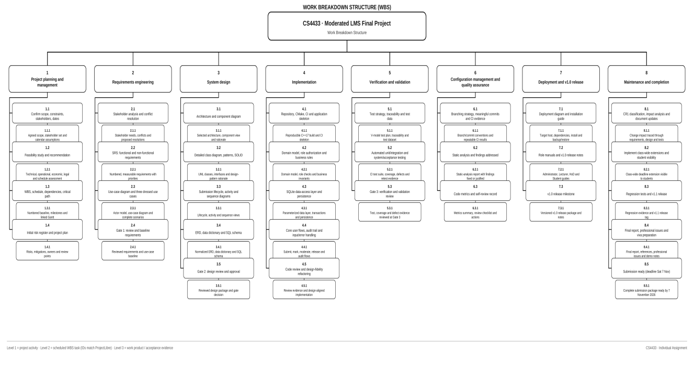
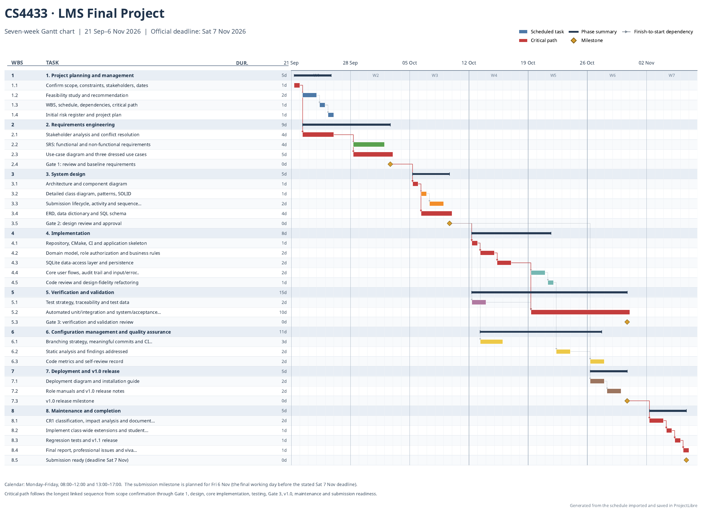

# CS4433projectplanningandmanagement

> Source document: `CS4433projectplanningandmanagement.docx`

## CS4433-  PROJECT MANAGEMENT PLAM

202320764

Itumeleng Raphoto

BSC Information Systems

## LEARNING MANAGEMENT SYSTEM FINAL PROJECT

Feasibility Study

Technical Feasibility

The proposed product is a bounded C++17 console or simple desktop application with SQLite persistence. These technologies support the specified account, course, assignment, submission, marking, moderation, and audit workflows without requiring cloud services or an always-on internet connection. CMake and a unit-testing framework support repeatable builds and verification; Git and a hosted CI service can support development even though the deployed application itself must work offline. The most technically demanding behavior is not the interface: it is enforcing role and record ownership checks consistently, preserving the submission/mark lifecycle, maintaining an accurate mark-change audit, and handling transactions and errors without corrupting data.

Technical feasibility is conditional on a deployment decision. The school must confirm its operating system, available compiler, memory/storage constraints, and whether “local network” means several users connected at once. SQLite is appropriate for a small, single-host installation, but the design should not assume that many separate clients can safely open a database file directly from an unreliable network share. If multiple users need concurrent access, use a single application/database host or obtain approval for a revised architecture; benchmark the chosen setup instead of claiming capacity. “800 students” is provisionally interpreted as 800 stored student accounts, not 800 simultaneous sessions. Verify the stated two-second response target on representative hardware and a representative dataset. Select a maintained password-hashing library rather than implementing a hash scheme, and test installation on the target machine before the deployment week.

Operational Feasibility

The main users which are teachers, students, HoDs, and an administrator have distinguishable tasks that map directly to the brief's role permissions. A simple, task-oriented console or desktop interface can avoid the training burden of a large LMS. The moderation-before-release rule creates a clear operational control: lecturers mark; HoDs review and release; students see only released marks and feedback. Accepting late submissions while applying a published, consistent penalty also accommodates the student representative's stated need without discarding work.

Operational readiness is not automatic. The school would need a process for creating/deactivating accounts, resetting credentials, assigning staff to courses, backing up/restoring the database, and handling a lost or corrupted school computer.

The Principal asks for simplicity, so a menu-driven console UI with role-specific menus, short prompts and clear error messages is appropriate. A one-page quick guide per role goes in the user manuals.The IT officer requires offline use, which the single-file SQLite database and local installation satisfy. A backup/restore copy of the database file will be part of the installation guide.

Economic feasibility

The project can be built with the required standard tools and commonly available open-source or no-cost development tools (C++17 compiler, CMake, SQLite, Git, and GoogleTest or Catch2). The financial case is therefore favorable provided that a suitable computer and storage/backup location are already available. No purchase, licence price, staff salary, or maintenance quote has been supplied, so it would be misleading to claim a complete monetary cost of ownership or a quantified return on investment.The cost for this individual assignment is effort, the current WBS estimates 70 focused hours.

Legal feasibility

The system would process identifiable account details and educational records, including enrolment, submissions, marks, feedback and audit history. The Lesotho Legal Information Institute (LesLII) lists the legislation as the Data Protection Act, 2012 (Act 5 of 2012), although section 1 gives its short title as the Data Protection Act, 2011. The Act was published in the Government Gazette on 22 February 2012 and, according to its text, commenced on publication (Data Protection Act, 2012). It applies to a data controller domiciled or principally based in Lesotho and, in specified cases, to controllers who use processing means located in Lesotho (Data Protection Act, 2012, ss. 1-3). The school's precise legal obligations and the Data Protection Commission's current procedures still need to be confirmed.

The statute makes legal feasibility a design constraint. It addresses lawful grounds for processing and data minimality (Data Protection Act, 2012, ss. 15-16), specified purposes and retention or deletion (ss. 18-19), reasonable security measures and notification of compromise (ss. 20, 23), notification to the Data Protection Commission before processing (s. 25(5)), and data subjects' rights of access and correction (ss. 26-27). It also restricts the processing of personal information about a child under parental control unless an exception applies, and section 36 lists prior parental consent among those exceptions (ss. 29, 36). Because a secondary school may have learners under 18, the school must decide the lawful processing basis, notices/consents or other applicable exceptions, controller responsibilities, retention period, and any required Commission notification before any identifiable learner data is used. Local/offline storage does not by itself remove those duties.

Schedule feasibility

The project has a fixed seven-week sequence and a current WBS estimate of 70 task hours, or about 10 focused hours per week. The estimate covers every major activity from requirements and UML/database design to C++/SQLite implementation, testing, CI, deployment, a maintenance change, and the 6,000-8,000 word report. It leaves no separately quantified reserve in the task-hour total. In addition, implementation cannot start until Gate 2 design approval, while v1.0 deployment, CR1/v1.1 maintenance, final reporting, and viva preparation are all due in the last two weeks. The profect’s required order and gate dependencies therefore create high schedule sensitivity.

The schedule is feasible only if  roughly 10 hours weekly can be protected and  preferably a further 7-hour contingency reserve, obtain prompt decisions on policy questions, and keep the product to its stated scope. Requirements and tests should be developed early; unit/integration testing and CI should run alongside implementation; and report sections should be updated as decisions are made rather than left until Week 7. The critical sequence is requirements/Gate 1 to design/Gate 2 to implementation to verification/Gate 3 and v1.0 to CR1/regression and final submission.

#### Feasibility recommendation

The recommendation is to continue with the project as technical and operational feasibility are positive for a simple local installation; economic feasibility is positive if suitable hardware is already available; legal feasibility depends on school confirmation of statutory obligations; and schedule feasibility depends on approximately 10 hours of focused work per week plus active scope control. Before Gate 1, confirm policy decisions and target-platform assumptions. Before Gate 2, demonstrate that the architecture, security approach, and database design address them. Before any real-data pilot, obtain the school's authorization and data-protection review. The minimum acceptable implementation must still satisfy all Must requirements, especially role-based access, moderation before release, secure password storage, persistent records, and mark-change auditing.

Work breakdown structure and schedule

Work breakdown structure

Gantt Chart

Risk management

Scoring method

Likelihood (L): 1 = Rare, 2 = Unlikely, 3 = Possible, 4 = Likely, 5 = Almost certain.

Impact (I): 1 = Negligible, 2 = Minor, 3 = Moderate, 4 = Major, 5 = Severe effect on required scope, schedule, security/privacy, data integrity, acceptance, or marks.

Exposure = L × I. The initial exposure below is the inherent score before the listed mitigations. At each gate, record the current/residual L, I, and exposure based on evidence.

Exposure bands: 1–4 Low; 5–9 Moderate; 10–16 High; 17–25 Very high.

Initial risk register

### Requirements(project)

Likelihood (L): 4   Impact (I): 4   Exposure: 16 , High

Risk event, cause and potential consequence: Conflicting or incomplete rules for mark release, late penalties, extensions, or resubmissions remain unresolved. Requirements, diagrams, code, and tests may then contradict each other, causing rework or unfair outcomes.

Mitigation and contingency: Maintain a decision/assumption log; send concise options to the supervisor and relevant stakeholders; resolve and baseline decisions at Gate 1; trace each approved rule to requirements and tests. If no decision is obtained, label the provisional assumption and its impact.

Accountable owner: Student (project manager); supervisor

Review points: Gate 1; revisit at Gate 2 and Gate 3 if a policy changes

Schedule (project)

Likelihood (L): 4   Impact (I): 5   Exposure: 20 , Very high

Risk event, cause and potential consequence: The 70-hour s estimate is compressed into seven weeks, with little built-in reserve. Design, integration, testing, CR1, and the final report could overrun and leave required evidence incomplete.

Mitigation and contingency: Track actual hours and progress weekly; protect about 10 focused hours per week and, if feasible, a separate 7-hour contingency reserve; draft report sections alongside the work; preserve verification time. If behind, defer optional interface polish and renegotiate scope/timing.

Accountable owner: Student

Review points: Weekly; formal re-score at Gates 1, 2, and 3

### Stakeholder availability (people)

Likelihood (L): 4   Impact (I): 4   Exposure: 16 , High

Risk event, cause and potential consequence: The IT officer, lecturers, HoD, student representative, or supervisor may be unavailable or respond too late to settle requirements and review decisions. Unverified assumptions can pass into design.

Mitigation and contingency: Book short reviews early; send focused questions and a decision deadline; use asynchronous responses where practical; keep an open-issues list. Escalate unanswered policy questions and retain them explicitly as assumptions until confirmed.

Accountable owner: Student (stakeholder liaison)

Review points: Gate 1 and Gate 2; recheck unresolved decisions at Gate 3

Performance (technical)

Likelihood (L): 4   Impact (I): 5   Exposure: 20 , Very high

Risk event, cause and potential consequence: Old hardware, unreliable internet, and an unclear meaning of “800 students on it” may make the offline C++/SQLite design too slow or unsuitable for the expected number of simultaneous users.

Mitigation and contingency: Confirm operating system, hardware, and whether 800 means stored accounts or concurrent users. Build a small CMake/SQLite spike; benchmark representative data on available hardware. Design SQLite for a single host unless concurrency is confirmed and tested. If multi-client use is required, obtain approval for a single-host service/revised design and revise the measurable performance requirement rather than claiming unsupported capacity.

Accountable owner: Student (technical lead)

Review points: Gate 1 for assumptions; Gate 2 for architecture; Gate 3 for measured evidence

### Security (technical)

Likelihood (L): 3   Impact (I): 5   Exposure: 15, High

Risk event, cause and potential consequence: A defect in role checks, student ownership checks, moderation, mark release, or the mark-change audit could expose or alter assessment records improperly.

Mitigation and contingency: Centralize authorization and deny by default,  test a role/permission and record-ownership matrix, keep marks hidden until HoD release, record who/when/old value/new value/reason for changes. Treat any failed authorization or audit test as a release blocker and fix/retest before packaging.

Accountable owner: Student (developer/test owner)

Review points: Gate 2 design review; Gate 3 security and acceptance tests

### Operational (technical)

Likelihood (L): 3   Impact (I): 4   Exposure: 12 ,  High

Risk event, cause and potential consequence: A crash, incomplete write, lost device, or failed backup could corrupt or destroy the SQLite database and project evidence.

Mitigation and contingency: Use transactions, constraints and error handling. Document backup/restore, test a restore from a separate cop, keep source and non-sensitive evidence in version control and never commit a real learner database or credentials. If corruption occurs, stop writes and restore the last verified copy.

Accountable owner: Student (developer/configuration manager)

Review points: Gate 2 data design; Gate 3 restore test; after major schema changes

### Quality (project)

Likelihood (L): 3   Impact (I): 5   Exposure: 15 , High

Risk event, cause and potential consequence: Testing starts too late or is left until after implementation, so boundary cases, exception flows, role security, or required coverage are not demonstrated by Gate 3.

Mitigation and contingency: Map requirements/use cases to test levels early, add unit/integration tests with features, run CI regularly. Test deadline/late-penalty boundaries, extensions, authorization, persistence, and exceptions. Do not pass Gate 3 or release v1.0 with unresolved critical defects; defer optional polish to protect verification.

Accountable owner: Student (test owner)

Review points: Weekly from design; Gate 2 test-plan review; Gate 3 evidence review

Operational  (people)

Likelihood (L): 3   Impact (I): 4   Exposure: 12 ,  High

Risk event, cause and potential consequence: The interface or instructions may be too difficult for teachers or other users, or the late-penalty behavior may be misunderstood as unfair or inconsistent.

Mitigation and contingency: Validate role workflows and late-penalty examples with the stakeholder questions; keep prompts, error messages, and role guides clear. Check keyboard access and basic accessibility, also demonstrate with synthetic data and record feedback. If user review is unavailable, document the usability assumptions and avoid claiming school-wide acceptance.

Accountable owner: Student (user liaison); lecturer/student representative consulted

Review points: Gate 1 workflow decisions; Gate 3 walkthrough/acceptance review

### Project capacity (people)

Likelihood (L): 3   Impact (I): 4   Exposure: 12,  High

Risk event, cause and potential consequence: As the sole developer, the student may lack experience in C++/SQLite/security tooling or lose work time to other commitments or illness, delaying critical tasks.

Mitigation and contingency: Check available hours weekly, start unfamiliar tools with small spikes, break work into demonstrable milestones, seek supervisor/technical guidance when blocked,  keep the 7-hour contingency if possible. If capacity drops, report it promptly and prioritize Must scope and verification rather than quietly compressing reviews.

Accountable owner: Student (self-owned)

Review points: Weekly; discuss capacity at every phase gate

## Reference

Data Protection Act, No. 5 of 2012 (Lesotho). Published in the Government Gazette, 22 February 2012. Lesotho Legal Information Institute. https://lesotholii.org/akn/ls/act/2012/5/eng@2012-02-22

## Figures and embedded images

