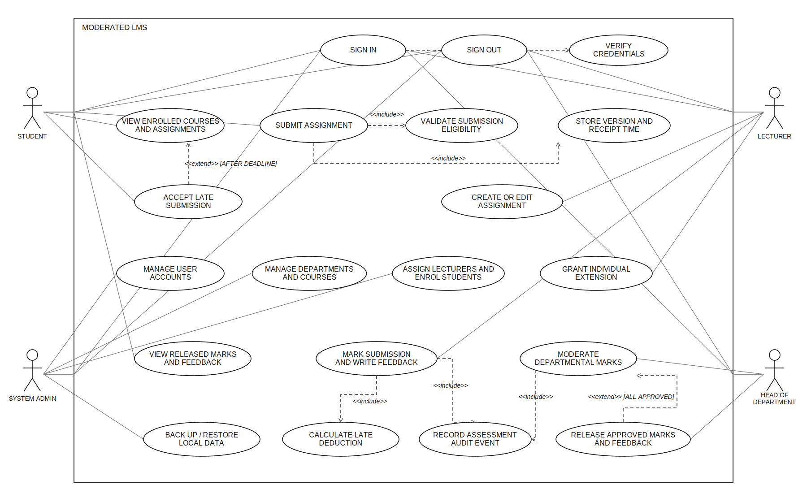

# CS4433Stakeholderanalysis,SRSandusecase

> Source document: `CS4433Stakeholderanalysis,SRSandusecase.docx`

Itumeleng Raphoto

202320764

Bsc. Information Systems

Requirements engineering

Stakeholders Analysis

Principal / project sponsor: Wants a simple system that teachers can use without IT expertise and that keeps marks hidden until Head of department review.

Lecturers / teachers: Need to set up assignments, grant justified extensions, mark submissions and provide feedback. One lecturer prefers immediate release of marks.

Head of Department (HoD): Needs to review marks before release and apply the stated late penalty consistently.

Students / student representative: Need to see their courses and assignments, receive a submission receipt, resubmit before the deadline, get feedback, and have late work recorded.

IT officer: Needs the system to work on older computers with unreliable internet, protect passwords and perform acceptably with 800 student records.

System administrator: Needs to manage accounts, departments, courses, lecturer assignments and enrollments, and to back up or restore local data.

Course supervisor / assessor: Needs evidence that the assignment requirements are met, including conflict resolution, a verifiable SRS and the use-case model.

Conflicts, Ambiguities, Resolution

System Requirements

Functional Requirements

Non Functional Requirements

Use case model

## Table 1

| Conflict/ Ambiguity | Resolution |
|---|---|
| Student representative asks that  / late work not to simply be rejected;  / Head of department specifies a penalty of 10% of  / the available mark per day for up  / to three days and zero thereafter.  / “Day” and the cutoff are  / ambiguous. / | Accept and timestamp late work  / while the assignment remains  / active. Let lateDays = ceil((receipt  / time − effective deadline) / 24  / hours). For late Days 1–3, subtract  / 0.10 × maximum mark × lateDays  / from the raw mark, floor at zero,  / and round to two decimals. More  / than 72 hours late receives zero.  / At exactly 72 hours, the three-day  / deduction applies. / |
| Students may resubmit before the  / deadline; the brief does not say  / whether prior versions are deleted  / or whether a late upload can  / replace an on-time attemp. / | Permit multiple versions up to and  / including the effective deadline;  / preserve every version and use the  / latest on-time version for marking.  / After the deadline, accept a late  / attempt if there is no on-time  / version; if an on-time version  / exists, retain later uploads for audit  / but do not replace the timely  / version for grading / |
| Lecturers may grant individual  / extensions, but the brief does not  / define who records the extension,  / what counts as approval, or  / whether it can be retroactive. / | Only the lecturer assigned to the  / course may record an individual  / extension. Store the reason,  / original deadline, new effective  / deadline, granting lecturer, and  / timestamp. Apply late rules from  / the effective deadline. Baseline  / assumption: extension is recorded  / before the current deadline; no  / retroactive extension unless the  / school explicitly approves it. / |
| IT requests 800 students on it, / offline operation and support for  / old computers; stored-account  / volume, concurrent workload,  / target device and response  / expectation are unspecified. / | Baseline the performance test at 800 stored student accounts and one local operator, not 800 simultaneous users. Run the  / specified response-time test on a  / school-nominated minimum  / computer. Do not claim multi / user/concurrent capacity until the  / IT officer defines it and a test  / demonstrates it. / |
| Principal wants a simple workflow  / for non-IT teachers, while the  / system must still support  / assessment, extensions and  / moderation. / | Use role-specific, task-labelled  / menus and require no more than  / five menu selections after sign-in  / to reach each role’s common task  / (assignment creation, marking  / queue, moderation queue, student  / submission). Show plain-language  / validation messages. / |
| HoD says every departmental  / mark must be seen before release,  / but does not specify whether one  / course/assessment can be  / released independently or the  / entire department must wait / | Proposed release unit: one  / assignment’s complete mark batch  / within a course. The HoD can view  / all courses/marks in the  / department, must review every  / record in the selected batch, and  / may release only when all batch  / entries are approved. Unrelated  / courses need not be held. / |
| Students want written feedback; the brief does not say whether feedback may be shown before the mark is moderated or separately from the mark. | Store feedback with the mark and release both together only after HoD approval. |

## Table 2

| ID | Requirement | Priority | verification |
|---|---|---|---|
| FR-01 | The system shall allow a registered user to sign in with an account identifier and password and to end the active session. | Must | Valid credentials open the correct role home. Invalid credentials do not create a session; sign-out invalidates the session. |
| FR-02 | The system shall enforce role- and record-scope authorization for Student, Lecturer, HoD and System Administrator actions. A student may access only their own records; a lecturer only assigned courses; an HoD only their department; an administrator only approved administrative functions. | Must | Execute the permission matrix for all four roles, every unauthorized attempt is denied and causes no data change. |
| FR-03 | The System Administrator shall be able to create, edit and deactivate accounts for the four roles; deactivation shall block subsequent sign-in without deleting linked academic records. | Must | Create/edit/deactivate one test account per role; verify deactivated login is denied and linked records remain. |
| FR-04 | The System Administrator shall be able to create and update departments and courses, with each course linked to exactly one department and a unique course code. | Must | Create/update valid records; duplicate course codes and missing departments are rejected. |
| FR-05 | The System Administrator shall be able to assign lecturers to courses and enrol or withdraw students from courses. | Must | Create and remove a lecturer-course link and student enrolment; verify resulting role-specific visibility. |
| FR-06 | A lecturer assigned to a course shall be able to create and edit an assignment with a title, instructions, effective due timestamp, maximum mark greater than zero, and active/inactive status. | Must | Create/edit an assignment; reject a missing title, non-positive maximum mark, or invalid due timestamp. |
| FR-07 | An assigned lecturer shall be able to grant an individual extension by recording the student, assignment, reason, original deadline, new effective deadline, granting lecturer and decision timestamp. | Must | An assigned lecturer’s extension changes only that student’s effective deadline; a non-assigned lecturer is denied; required fields persist. |
| FR-08 | A student shall be able to view only their enrolled courses and active assignments for those courses, including the maximum mark and effective due timestamp. | Must | Compare displayed course/assignment list with enrolment data; non-enrolled course and inactive assignment are absent. |
| FR-09 | A student shall be able to submit an assignment attempt while the assignment is active. Each attempt shall preserve the file, student, assignment, version number, receipt timestamp, file metadata and checksum. Resubmission on or before the effective deadline shall create a new version without deleting earlier versions. | Must | Submit and resubmit a synthetic file; confirm unique ordered versions, exact receipt times and that previous files remain retrievable. |
| FR-10 | The system shall accept and record valid late submission attempts rather than silently rejecting them; it shall flag late status and identify attempts more than 72 hours past the effective deadline for a zero award. | Must | Test on-time, 1 minute late, exactly 24h, exactly 72h and 72h+1 second; every valid file is recorded and the >72h case is flagged for zero. |
| FR-10 | The system shall accept and record valid late submission attempts rather than silently rejecting them; it shall flag late status and identify attempts more than 72 hours past the effective deadline for a zero award. | Must | Test on-time, 1 minute late, exactly 24h, exactly 72h and 72h+1 second; every valid file is recorded and the >72h case is flagged for zero. |
| FR-11 | When marking, the system shall calculate a late deduction of 10% of the assignment maximum mark for each late day (maximum three deductions); after 72 hours the final awarded mark shall be zero. The calculated final mark shall not be below zero. | Must | For maximum=100 and raw=80, verify 0, 10, 30 and >72h late yield final marks 80, 70, 50 and 0; verify floor at zero and extension boundary. |
| FR-12 | A lecturer assigned to the course shall be able to record a raw mark from zero through the assignment maximum and written feedback for a submission. | Must | Valid boundary marks 0 and maximum are accepted; values outside the range are rejected; feedback is persisted with the mark. |
| FR-13 | The system shall keep marks and feedback hidden from students until the HoD releases the complete, approved mark batch for the assessment. Only an HoD for the department may release that batch. | Must | Student queries return no mark/feedback before release; release is disabled until all batch records are reviewed; unauthorized role cannot release. |
| FR-14 | After release, a student shall be able to view their own final mark and written feedback for the relevant enrolled course and assignment. | Must | After release, the student sees only their own final mark/feedback; another student’s record remains inaccessible. |

## Table 3

| ID | Attribute | Measurable requirement | Priority | Verification |
|---|---|---|---|---|
| NFR-01 | Performance | With 800 student accounts stored and the nominated baseline school computer recorded in the test report, the 95th-percentile time for sign-in, course/assignment list, and mark-list retrieval shall each be ≤2.0 seconds over 30 measured runs per operation. Test uses one local operator; it does not claim 800 concurrent sessions. | Must | Record hardware, dataset size, 30 timings per operation, percentile and pass/fail. |
| NFR-02 | Offline operation | After installation and local configuration, the core flows (sign-in, course/assignment view, submission, marking, moderation, release and student view) shall complete for an 8-hour simulated school day with the internet disconnected and without external service calls. | Must | Disable network access, run each flow, restart once, and inspect for external network dependency. |
| NFR-03 | Password confidentiality | The database and application logs shall contain no plaintext password. Password verification shall use a maintained salted adaptive password-hashing library; each account shall have a unique salt and only the derived verifier shall be stored. | Must | Inspect database/logs and test correct/incorrect credentials and distinct salts for two accounts. |
| NFR-04 | Authorization security | For every protected operation in the role-permission matrix, all unauthorized role/record-owner test cases shall be denied, with zero unauthorized reads or writes in the test suite. | Must | Automated positive/negative role and record-scope matrix; 100% of negative cases denied. |
| NFR-05 | Audit integrity | For 100% of grade, moderation and release changes exercised by tests, the corresponding audit event shall commit atomically with the change; if audit persistence fails, the underlying grade/release change shall roll back. | Must | Fault-inject audit-write failure and compare database state; inspect event completeness for each change path. |
| NFR-06 | Data integrity | After the full acceptance-test suite and after each simulated interrupted transaction, SQLite foreign-key checking shall return zero violations; incomplete multi-record operations shall leave no partial logical record. | Must | Run PRAGMA foreign_key_check and transaction rollback tests for submission, mark and release operations. |

## Figures and embedded images

