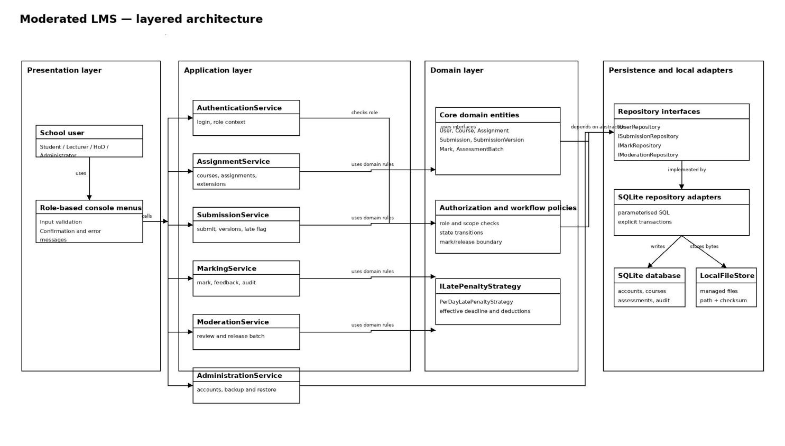
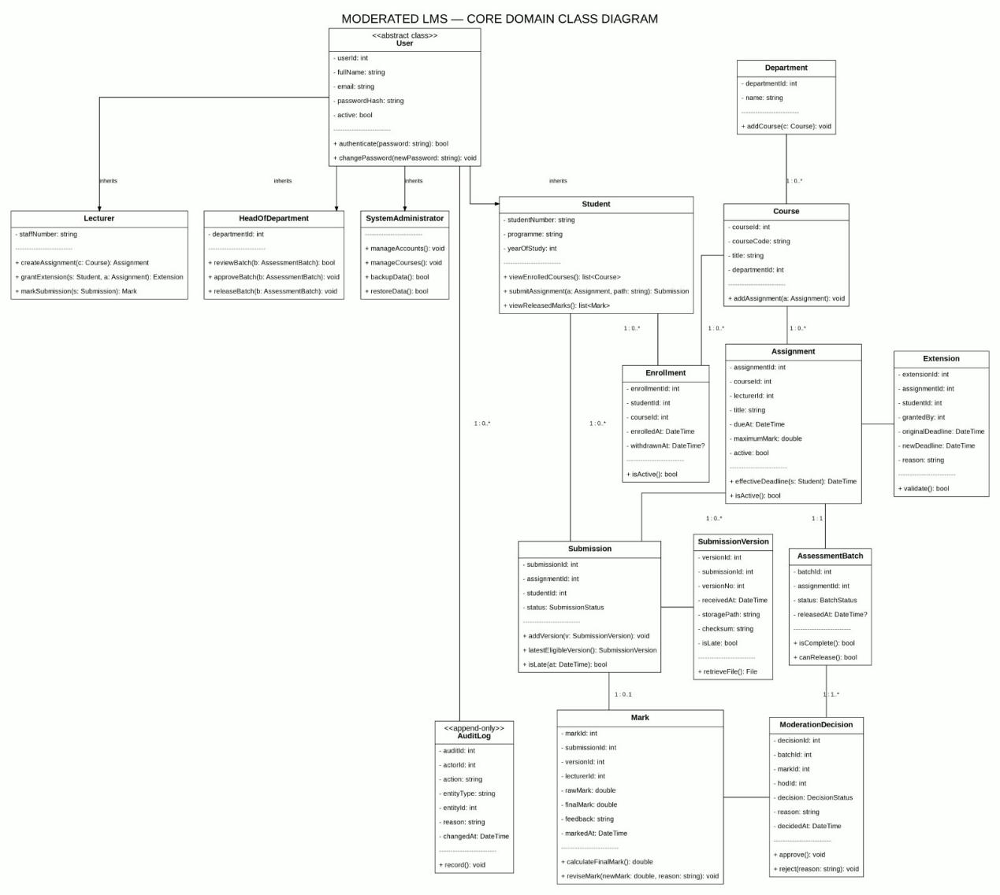
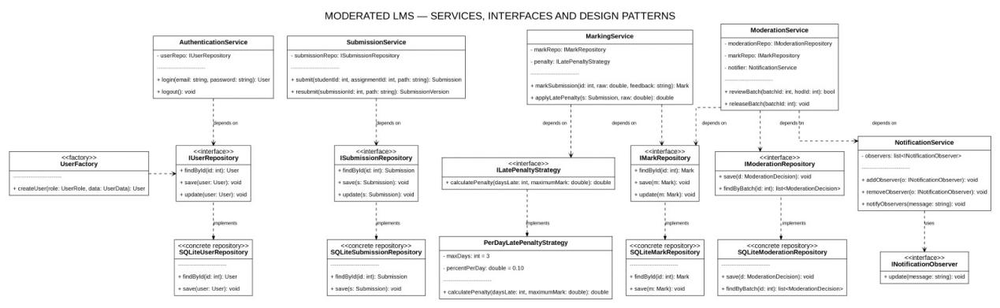
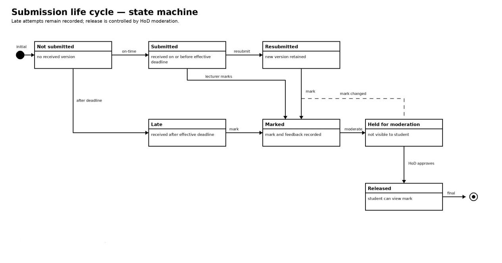
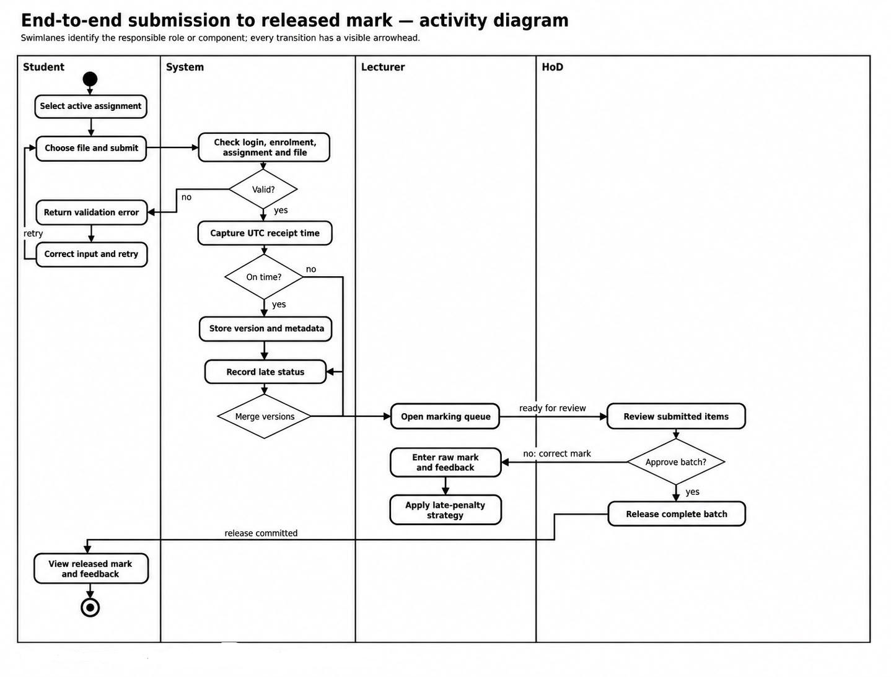
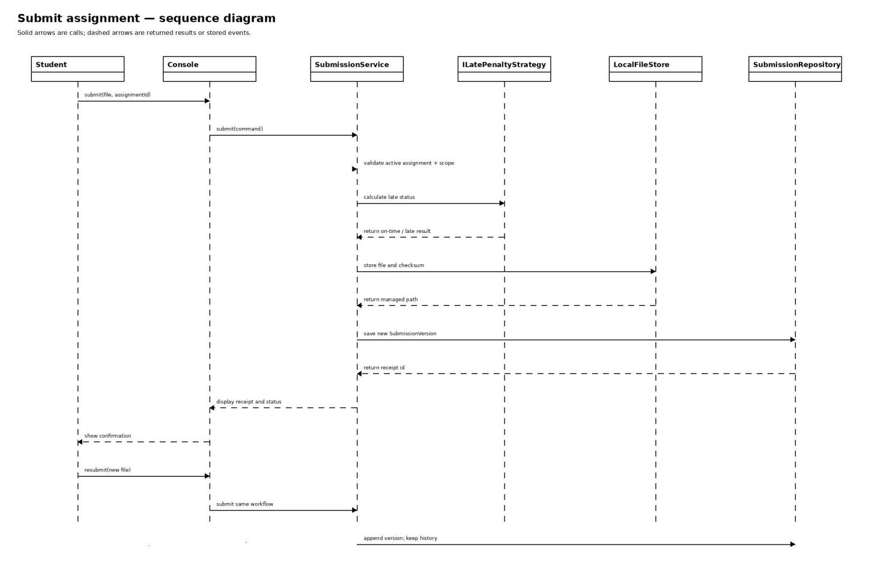
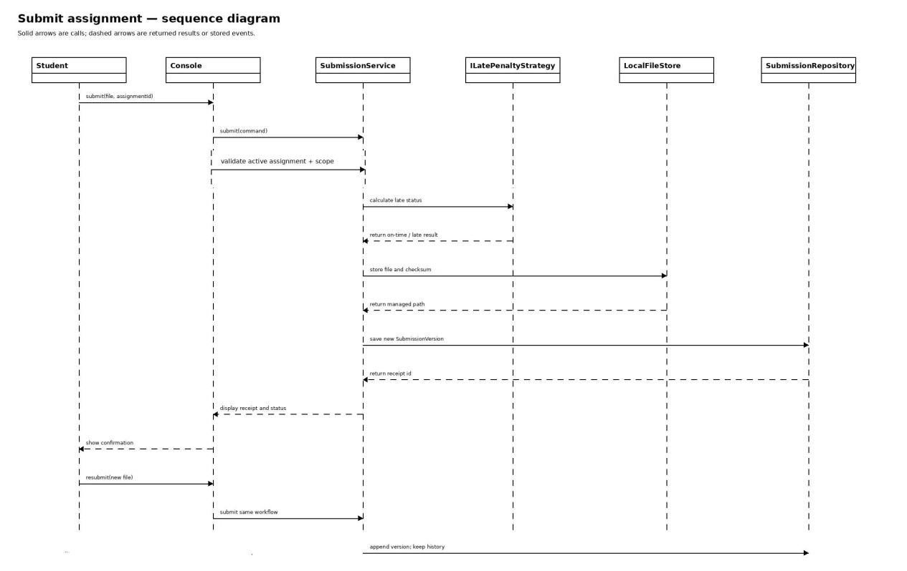
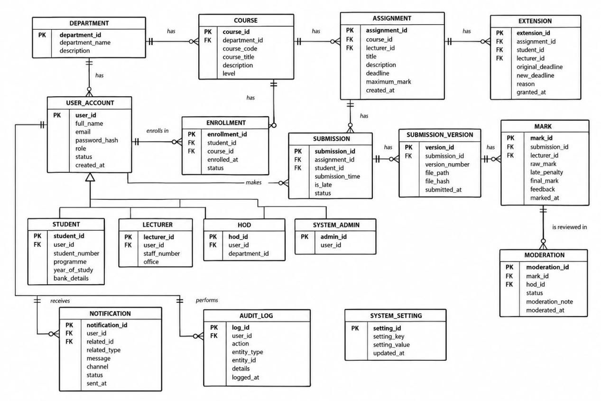

# CS4431SoftwareDesign

> Source document: `CS4431SoftwareDesign.docx`

Itumeleng Raphoto

202320764

Bsc. Information Systems

System Design

Architecture

Selected architectural style: layered architecture

The proposed system uses a layered architecture. The presentation layer contains the role-based console menus and input validation. The application layer coordinates the main workflows. The domain layer contains the academic entities and rules. The persistence layer contains repository implementations for SQLite and a separate local file adapter for submitted files.

This style fits the project because the current system is a small offline C++17 application rather than a networked web platform. It keeps terminal concerns separate from marking, moderation, authorization and late-penalty rules. A service can therefore be tested with fake repository interfaces without opening the console or connecting to the real database. It also leaves the presentation layer replaceable if a desktop interface is requested later.

## Layered component architecture diagram

## Component responsibilities and dependency rule

Presentation layer: Shows role-specific menus, validates input and displays confirmations or errors. It does not issue SQL, write files directly or calculate marks.

Application layer: Coordinates authentication, course and assignment setup, submission, marking, moderation/release, administration and backup workflows.

Domain layer: Represents users, courses, assignments, submissions, marks and assessment batches. It enforces role/scope checks, lifecycle transitions, release rules and the late-penalty strategy.

Persistence and local adapters: Implements repository interfaces with parameterised SQLite statements and explicit transactions. LocalFileStore keeps submission bytes outside the database while SQLite stores metadata and checksums.

The dependency rule is inward-facing: console menus call application services; application services use domain policies and repository interfaces; SQLite and local-file classes sit at the edge as replaceable adapters. This prevents business logic from depending directly on terminal code, SQL statements or a particular file-system implementation.

## Alternative considered and rejected

Model-View-Controller (MVC) was considered because it is a familiar way to separate user interaction from application logic. It was not selected as the main architecture because the current brief describes a small console application, not a rich graphical or web interface. Most of the design risk is in authorization, submission state, marking, moderation and atomic release rather than in view rendering. MVC would add controller and view concepts without improving the main separation needed for this version. If the system later gains a desktop GUI, the presentation layer can be reorganized using MVC while the application, domain and persistence layers remain largely unchanged.

Class Diagram

Design-level class model

The class model below turns the Week 2 requirements into implementation-level objects. It shows the four user roles, academic objects, submission version history, marking and moderation records. Private state is marked with “-”; public operations are marked with “+”. Types and return values are included so the diagram can guide a C++17 implementation rather than only describing concepts.

## Services, interfaces and patterns

Application services coordinate use cases but do not contain SQL or hard-code the late-penalty formula. They depend on interfaces, which keeps the core rules independent of SQLite and makes unit testing possible with test doubles.

## Design patterns applied

Strategy for late-penalty rules: MarkingService depends on ILatePenaltyStrategy rather than calculating deductions itself. PerDayLatePenaltyStrategy is the current implementation. This was chosen because the school may change the number of penalty days, percentage or zero-mark rule. A different policy can be substituted without rewriting submission handling, mark storage or moderation.

Repository/DAO : Interfaces such as ISubmissionRepository and IMarkRepository define the operations required by the services. SqliteSubmissionRepository and SqliteMarkRepository implement them using parameterised SQL and transactions. This was chosen to keep database details at the system boundary, support fake repositories in unit tests and protect the domain classes from SQLite APIs.

Factory for user creation: UserFactory creates Student, Lecturer, HeadOfDepartment or SystemAdministrator objects from a role and account data. This was chosen so account-loading and account-creation code does not contain repeated conditional construction logic. Adding another role is localized to the factory and the new role class.

## SOLID principles in the design

Single Responsibility: Submission owns submission state and versions; MarkingService calculates and records marks; ModerationService handles

review and release; repositories handle persistence. No class is responsible for the whole workflow.

Open/Closed: ILatePenaltyStrategy allows new penalty policies without modifying MarkingService. New repository implementations can replace SQLite adapters without changing application services.

Liskov Substitution: Each concrete user role can be used wherever User is expected. Repository implementations can be substituted for their interfaces, and every penalty strategy returns the same penalty calculation contract.

Interface Segregation: Services depend on focused interfaces such as ISubmissionRepository, IMarkRepository and ILatePenaltyStrategy instead of one large database interface containing unrelated operations.

Dependency Inversion: Application services depend on abstractions. Concrete SQLite repositories, the file store and the selected penalty policy are injected at the application boundary rather than created inside the business rules.

Behavioral Models

## Submission life cycle; state machine

The submission begins in Not submitted and moves to Submitted when the system accepts an on-time attempt. A receipt after the effective deadline moves the item to Late. Resubmissions create additional versions rather than replacing history. The selected version is marked, held while the batch is moderated, and becomes visible only after release. If a mark changes after approval, the item returns to Marked and the previous approval is no longer valid.

## End-to-end process  Activity diagram

The activity diagram separates the student, system, lecturer and HoD responsibilities. The system captures receipt time, classifies late status, stores each version and prevents release until the HoD has reviewed the complete assessment batch. Invalid input returns to the student, while a rejected moderation decision returns the item for correction.

Sequence Diagram

Submit assignment

The submit sequence includes the normal on-time path, late classification, file storage and the resubmission path. Every accepted upload is stored as a new SubmissionVersion. A later late upload does not silently delete an earlier version or change the effective-deadline decision.

## Moderate and release marks

## The HoD reviews the assessment batch through ModerationService. Before release, the service verifies that the marks are still valid, records the decision in the audit repository and commits the release operation through the mark repository. The student-facing view is notified only after the release transaction succeeds.

## Behavioural decisions represented

Deadline classification: Receipt at or before the effective deadline is on time. The system captures UTC receipt time; the student does not type it.

Late work: Late work is accepted while the assignment is active and is retained. The late-penalty strategy determines the final mark when it is marked.

Resubmission: Every attempt is retained. The latest eligible on-time attempt is preferred for marking; if none exists, the latest eligible late attempt may be selected.

Release boundary: Marks and feedback remain hidden until the HoD approves the complete batch and the release transaction commits.

## Database Design

## Normalised ERD

The design is in Third Normal Form. Each table stores one subject or one relationship. Many-to-many relationships are separated into Lecturer and Enrolment. Submission files are separated into SubmissionVersion, and role-specific details are separated from the common UserAccount table. This avoids repeated data and update anomalies.

## Short data dictionary

## SQL schema

The application enables foreign keys and uses parameterised SQL. CHECK constraints handle simple validation; the services handle rules that involve more than one table, such as lecturer scope, late penalties and complete-batch release.

PRAGMA foreign_keys = ON;

CREATE TABLE department (

department_id INTEGER PRIMARY KEY,

name TEXT NOT NULL UNIQUE

);

CREATE TABLE user_account (

user_id INTEGER PRIMARY KEY,

username TEXT NOT NULL UNIQUE,

password_hash TEXT NOT NULL,

role TEXT NOT NULL CHECK (role IN ('STUDENT','LECTURER','HOD','ADMIN')),

active INTEGER NOT NULL DEFAULT 1 CHECK (active IN (0,1)),

created_at TEXT NOT NULL

);

CREATE TABLE student_profile (

user_id INTEGER PRIMARY KEY REFERENCES user_account(user_id),

student_number TEXT NOT NULL UNIQUE

);

CREATE TABLE lecturer_profile (

user_id INTEGER PRIMARY KEY REFERENCES user_account(user_id),

staff_number TEXT NOT NULL UNIQUE

);

CREATE TABLE hod_department (

hod_user_id INTEGER NOT NULL REFERENCES user_account(user_id),

department_id INTEGER NOT NULL REFERENCES department(department_id),

PRIMARY KEY (hod_user_id, department_id)

);

CREATE TABLE course (

course_id INTEGER PRIMARY KEY,

course_code TEXT NOT NULL UNIQUE,

name TEXT NOT NULL,

department_id INTEGER NOT NULL REFERENCES department(department_id)

);

CREATE TABLE course_lecturer (

course_id INTEGER NOT NULL REFERENCES course(course_id),

lecturer_id INTEGER NOT NULL REFERENCES lecturer_profile(user_id),

assigned_at TEXT NOT NULL,

PRIMARY KEY (course_id, lecturer_id)

);

CREATE TABLE enrolment (

course_id INTEGER NOT NULL REFERENCES course(course_id),

student_id INTEGER NOT NULL REFERENCES student_profile(user_id),

enrolled_at TEXT NOT NULL,

withdrawn_at TEXT,

PRIMARY KEY (course_id, student_id)

);

CREATE TABLE assignment (

assignment_id INTEGER PRIMARY KEY,

course_id INTEGER NOT NULL REFERENCES course(course_id),

lecturer_id INTEGER NOT NULL REFERENCES lecturer_profile(user_id),

title TEXT NOT NULL,

instructions TEXT NOT NULL,

effective_due_at TEXT NOT NULL,

maximum_mark REAL NOT NULL CHECK (maximum_mark > 0),

active INTEGER NOT NULL DEFAULT 1 CHECK (active IN (0,1))

);

CREATE TABLE extension (

extension_id INTEGER PRIMARY KEY,

assignment_id INTEGER NOT NULL REFERENCES assignment(assignment_id),

student_id INTEGER NOT NULL REFERENCES student_profile(user_id),

new_due_at TEXT NOT NULL,

reason TEXT NOT NULL,

granted_by INTEGER NOT NULL REFERENCES lecturer_profile(user_id),

granted_at TEXT NOT NULL,

UNIQUE (assignment_id, student_id)

);

CREATE TABLE submission (

submission_id INTEGER PRIMARY KEY,

assignment_id INTEGER NOT NULL REFERENCES assignment(assignment_id),

student_id INTEGER NOT NULL REFERENCES student_profile(user_id),

status TEXT NOT NULL CHECK (status IN ('SUBMITTED','LATE','MARKED','HELD','RELEASED')),

UNIQUE (assignment_id, student_id)

);

CREATE TABLE submission_version (

version_id INTEGER PRIMARY KEY,

submission_id INTEGER NOT NULL REFERENCES submission(submission_id),

version_no INTEGER NOT NULL CHECK (version_no > 0),

received_at TEXT NOT NULL,

storage_path TEXT NOT NULL,

checksum TEXT NOT NULL,

is_late INTEGER NOT NULL CHECK (is_late IN (0,1)),

UNIQUE (submission_id, version_no)

);

CREATE TABLE mark (

mark_id INTEGER PRIMARY KEY,

submission_id INTEGER NOT NULL UNIQUE REFERENCES submission(submission_id),

version_id INTEGER NOT NULL REFERENCES submission_version(version_id),

raw_mark REAL NOT NULL CHECK (raw_mark >= 0),

final_mark REAL NOT NULL CHECK (final_mark >= 0),

feedback TEXT NOT NULL,

marked_by INTEGER NOT NULL REFERENCES lecturer_profile(user_id),

marked_at TEXT NOT NULL

);

CREATE TABLE assessment_batch (

batch_id INTEGER PRIMARY KEY,

assignment_id INTEGER NOT NULL UNIQUE REFERENCES assignment(assignment_id),

status TEXT NOT NULL CHECK (status IN ('OPEN','APPROVED','RELEASED')),

released_at TEXT

);

CREATE TABLE moderation_decision (

decision_id INTEGER PRIMARY KEY,

batch_id INTEGER NOT NULL REFERENCES assessment_batch(batch_id),

mark_id INTEGER NOT NULL REFERENCES mark(mark_id),

hod_user_id INTEGER NOT NULL REFERENCES user_account(user_id),

decision TEXT NOT NULL CHECK (decision IN ('APPROVED','REJECTED')),

reason TEXT NOT NULL,

decided_at TEXT NOT NULL,

UNIQUE (batch_id, mark_id)

);

CREATE TABLE audit_log (

audit_id INTEGER PRIMARY KEY,

changed_by INTEGER NOT NULL REFERENCES user_account(user_id),

entity_type TEXT NOT NULL,

entity_id INTEGER NOT NULL,

action TEXT NOT NULL,

old_value TEXT,

new_value TEXT,

reason TEXT NOT NULL,

changed_at TEXT NOT NULL

);

## 4. Mapping to the class diagram

## 5. Brief design justification

The class diagram describes objects and behaviour, while the database stores durable facts. For example, calculateFinal() and the late-penalty Strategy remain in the domain layer; the database stores raw_mark, final_mark and the submission timing needed to reproduce the result. User inheritance is represented with one common account table and role-specific tables because this avoids four copies of username and password data. AssessmentBatch is stored even though it could be calculated from an assignment and its marks, because it gives moderation and release a clear transaction boundary.

The database does not store submitted file bytes. It stores a local storage path and checksum, while the local file adapter stores the actual file. This keeps SQLite small and still allows the system to verify that a submission has not been changed.

## Table 1

| Table | Important columns and constraints | Purpose |
|---|---|---|
| user_account | user_id PK; username UNIQUE; password_hash; role; active; created_at | Stores login and role information. Passwords are stored as salted hashes. |
| student_profile | user_id PK/FK; student_number UNIQUE | Student details linked to one user account. |
| lecturer_profile | user_id PK/FK; staff_number UNIQUE | Lecturer details linked to one user account. |
| hod_department | hod_user_id PK/FK; department_id PK/FK | Shows which department a HoD may moderate. |
| department | department_id PK; name UNIQUE | School department. |
| course | course_id PK; course_code UNIQUE; name; department_id FK | A course belongs to one department. |
| course_lecturer | course_id PK/FK; lecturer_id PK/FK; assigned_at | Resolves the lecturer–course many-to-many relationship. |
| enrolment | course_id PK/FK; student_id PK/FK; enrolled_at; withdrawn_at | Resolves the student–course many-to-many relationship. |
| assignment | assignment_id PK; course_id FK; lecturer_id FK; title; effective_due_at; maximum_mark; active | Assessment created by an assigned lecturer. |
| extension | extension_id PK; assignment_id FK; student_id FK; new_due_at; reason; granted_by FK | Individual student extension. |
| submission | submission_id PK; assignment_id FK; student_id FK; status | One logical submission per student and assignment. |
| submission_version | version_id PK; submission_id FK; version_no; received_at; storage_path; checksum; is_late | Immutable upload history, including resubmissions. |
| mark | mark_id PK; submission_id UNIQUE/FK; version_id FK; raw_mark; final_mark; feedback; marked_by FK | Mark and feedback for the selected submission version. |
| assessment_batch | batch_id PK; assignment_id UNIQUE/FK; status; released_at | The complete assignment batch used for moderation and release. |
| moderation_decision | decision_id PK; batch_id FK; mark_id FK; hod_user_id FK; decision; reason; decided_at | HoD decision for a mark in a batch. |
| audit_log | audit_id PK; changed_by FK; entity_type; entity_id; action; old_value; new_value; reason; changed_at | Append-only history of mark and moderation changes. |

## Table 2

| Class or design element | Table(s) | Why |
|---|---|---|
| User | user_account plus one role profile table | Relational inheritance uses shared account data and separate StudentProfile, LecturerProfile and HoDDepartment rows. |
| Student / Lecturer / HeadOfDepartment / SystemAdministrator | user_account and the relevant profile or role value | The C++ classes provide polymorphism; the database stores the data needed to recreate the correct object. |
| Course | course, course_lecturer and enrolment | The two relationship tables replace collection attributes and resolve many-to-many relationships. |
| Assignment / Extension | assignment / extension | Direct mapping of assessment and individual deadline-extension records. |
| Submission / SubmissionVersion | submission / submission_version | Submission is the logical record; each upload is a separate version so history is not lost. |
| Mark / AssessmentBatch / ModerationDecision | mark / assessment_batch / moderation_decision | These tables keep marking, complete-batch moderation and release separate. |
| Repositories, services, UserFactory and ILatePenaltyStrategy | No direct table | They are application behaviour, not stored business entities. Their results are stored through the tables above. |

## Figures and embedded images

