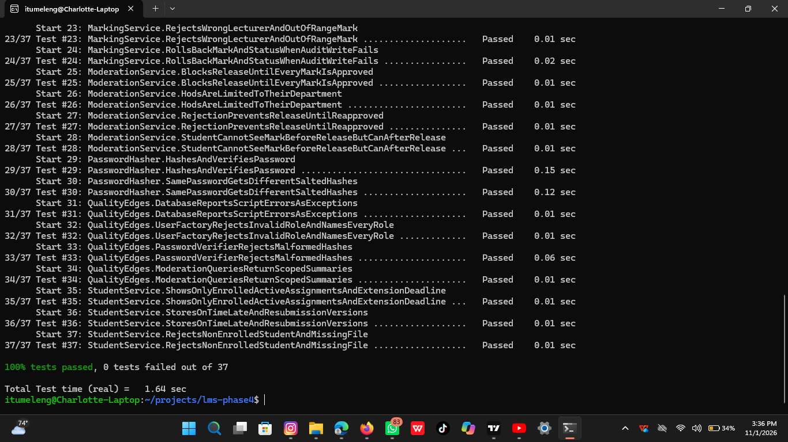
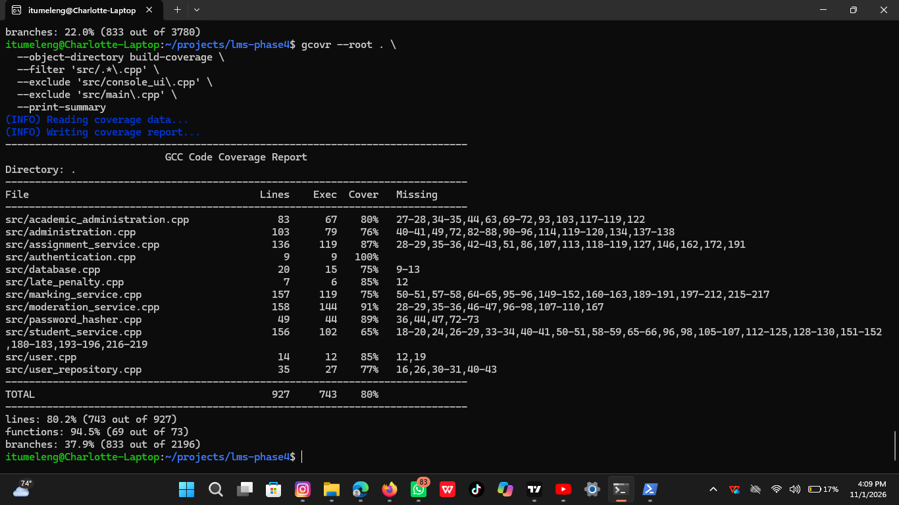
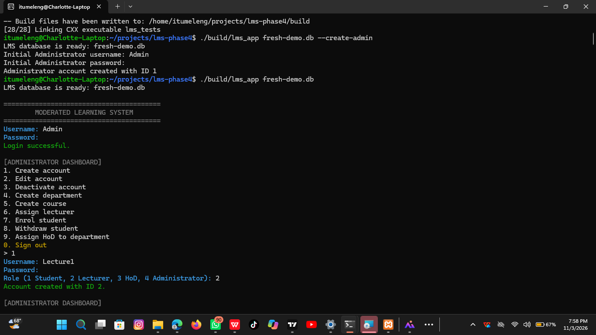
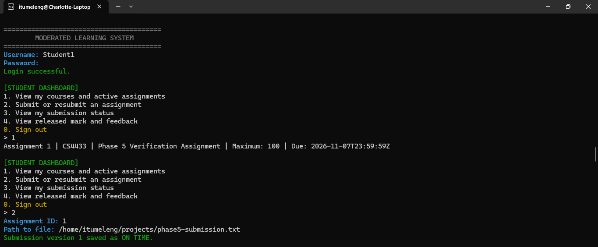
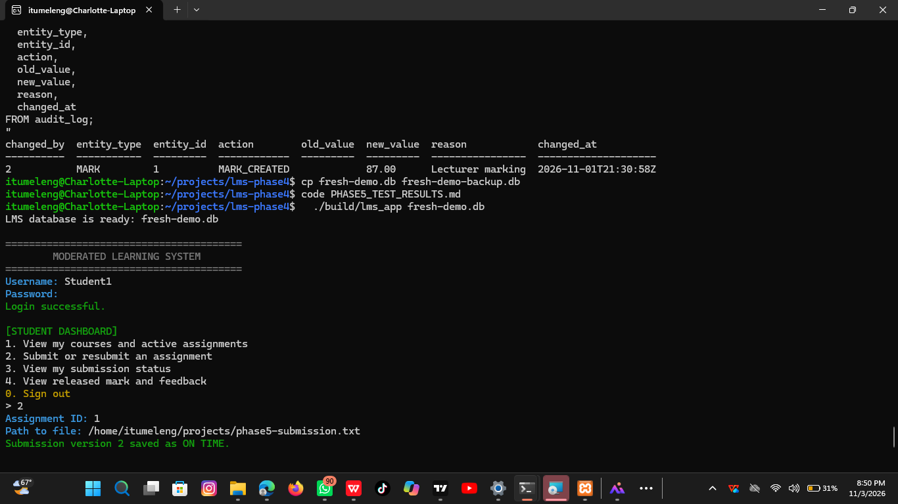
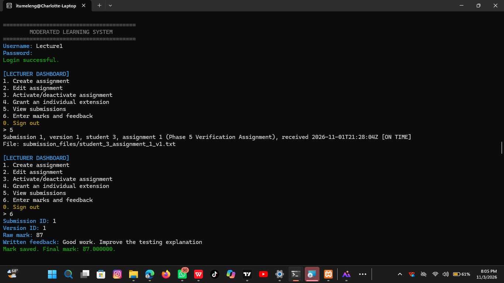
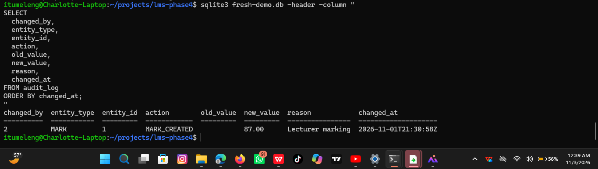
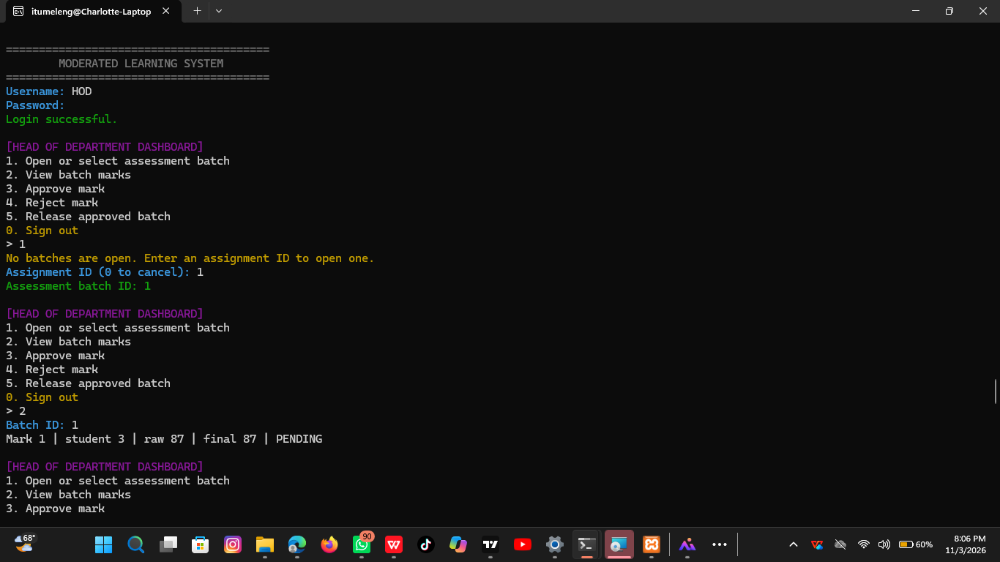
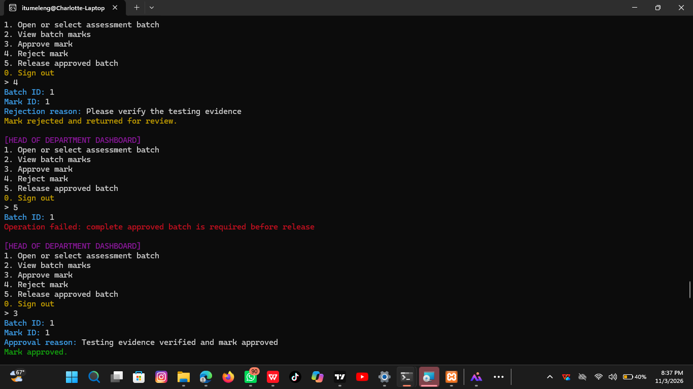
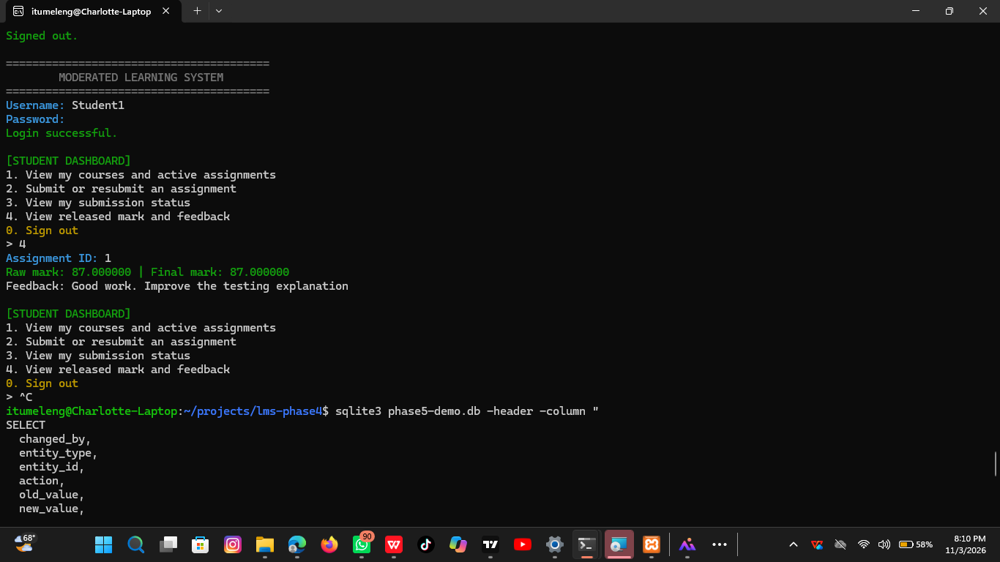

# Phase5ScreenshotPlacementGuide

> Markdown conversion of the exact supplied Word document `Phase5ScreenshotPlacementGuide.docx`.

Phase 5 Screenshot Placement Guide

Recommended document order

Screenshots with relevant acceptance-test row in PHASE5_TEST_RESULTS.md

Screenshot mapping

Screenshot 1 — Build and automated tests

## Execution summary

Shows: CMake build and the final CTest result.

Figure 1. C++17 build and automated verification completed successfully: 37 of 37 tests passed.

Maps to: General Phase 5 exit criteria and automated verification.

Picture name: phase5-01-build-tests.png.

Screenshot 2 — Administrator setup

The AT-01 row in ## Acceptance execution record.

Shows: Administrator dashboard with accounts, department, course, lecturer assignment, HoD assignment, and student enrolment completed.

Figure 2. Administrator completed the academic structure and role-account setup.

Maps to: AT-01 — Administrator setup.

Picture name: phase5-02-admin-setup

Screenshot 3 — Student submits assignment

The AT-02 row.

Shows: Student dashboard displaying the active assignment and the successful submission message.

Figure 3. Enrolled student submitted the active assignment and the system recorded the first version and submission status.

Maps to: AT-02 — Submit assignment.

Picture name: phase5-03-student-submission

Screenshot 4 — Student resubmits assignment

The AT-03 row.

Shows: Successful resubmission and the version-2 result.

Figure 4. The student resubmitted the assignment; version 2 was stored while version 1 remained available.

Maps to: AT-03 — Resubmit assignment.

Picture name: phase5-04-student-resubmission.

Screenshot 5 — Lecturer marks submission

The AT-04 row.

Shows: Lecturer submission view, entered raw mark, feedback, and successful marking message.

Figure 5. The assigned lecturer marked the scoped submission and recorded feedback.

Maps to: AT-04 — Mark and audit.

Picture name: phase5-05-lecturer-marking

Screenshot 6 — Audit log

Shows: SQLite query output containing changed_by, entity_type, action, new_value, reason, and changed_at.

This query is used after stopping the LMS:

sqlite3 fresh-demo.db -header -column "

SELECT changed_by, entity_type, entity_id, action,

old_value, new_value, reason, changed_at

FROM audit_log

ORDER BY changed_at;

"

Figure 6. The mark change was persisted in the audit log with the actor, timestamp, old/new values, and reason.

Maps to: AT-04 — Mark and audit; SRS audit-log requirement.

Picture name: phase5-06-audit-log

Screenshot 7 — HoD moderation and release

The AT-05 row.

Shows: HoD approval or rejection, release-blocking result when appropriate, and successful release after all marks are approved.

Figure 7. The HoD moderated the assessment batch and released it only after the required marks were approved.

Maps to: AT-05 — Moderate and release.

Picture names: phase5-07-hod-moderation and phase5-07b-hod-release

Screenshot 8 — Student views released result

The AT-06 row.

Shows: Student result screen displaying the final mark and written feedback after release.

Figure 8. The student could view the final mark and feedback after HoD release; the mark was hidden before release.

Maps to: AT-06 — Student result visibility.

Screenshot 9 — Coverage result

Coverage evidence.

Shows: Coverage tool output showing 80% line coverage.

Figure 9. Automated coverage measurement achieved 80% line coverage, exceeding the required 70% threshold.

Maps to: Coverage evidence and the assignment quality requirement.

Picture fname: phase5-09-coverage-80-percent

Completed acceptance table template

## Table 1

| ID | Result | Screenshot evidence |
|---|---|---|
| AT-01 | PASS | Figure 2 / phase5-02-admin-setup.png |
| AT-02 | PASS | Figure 3 / phase5-03-student-submission.png |
| AT-03 | PASS | Figure 4 / phase5-04-student-resubmission.png |
| AT-04 | PASS | Figures 5–6 / lecturer marking and audit log |
| AT-05 | PASS | Figure 7 / HoD moderation and release |
| AT-06 | PASS | Figure 8 / student released result |

## Embedded screenshots and figures

