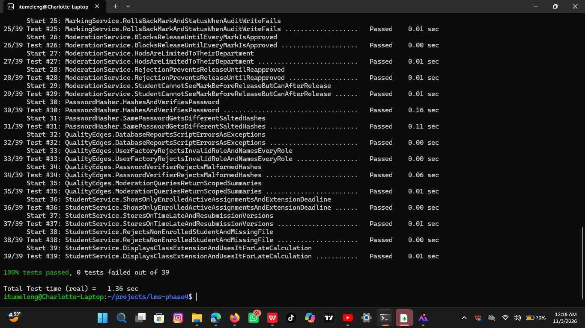
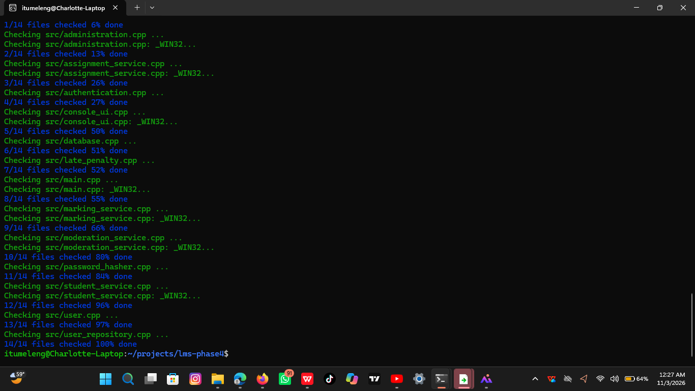
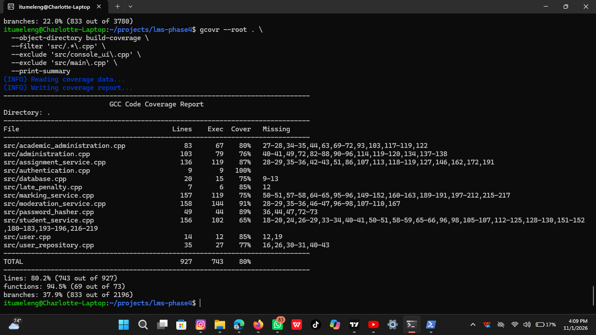
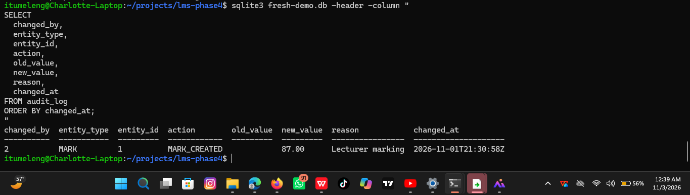
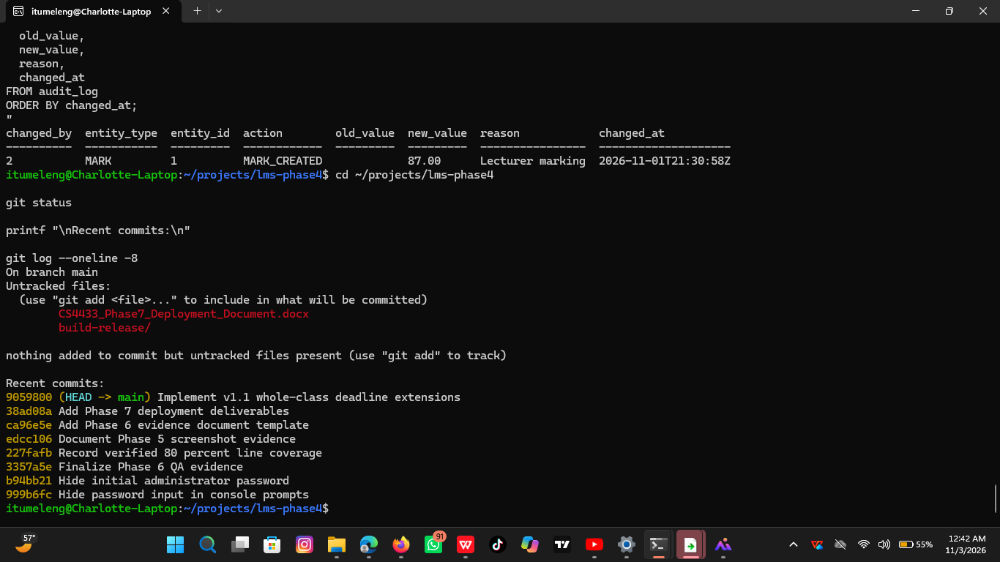

# Phase6 ConfigurationManagementandQualityAssuranceEvidence

> Source document: `Phase6_ConfigurationManagementandQualityAssuranceEvidence.docx`

Phase 6: Configuration Management and Quality Assurance Evidence

Student: Itumeleng Raphoto 202320764
Project: C++17 Moderated Learning Management System
Repository: CS4433-LMS-Phase4
Date: 03-11-2026

This document records the final Phase 6 quality-assurance evidence.

1. Release build and automated tests

The project was built using C++17, CMake, and Ninja in Release mode. The complete automated test suite passed.

## Result

100% tests passed, 0 tests failed out of 37

Figure 1. Successful C++17 Release build and execution of all 37 automated tests.

2. Static analysis with cppcheck

Cppcheck was run against the production source files using C++17 analysis settings. All 14 production source files were checked with no reported findings.

Figure 2. Cppcheck completed for the production source files without reported findings.

3. Test coverage

The measured implementation line coverage was 80%, exceeding the assignment minimum requirement of 70%.

Figure 3. Coverage measurement showing 80% line coverage.

4. Persistent audit-log evidence

Mark changes are recorded with the responsible user, entity, action, old and new values, reason, and UTC timestamp. The evidence was obtained from the demonstration database using the audit_log table.

Figure 4. Persistent audit-log entry showing the actor, mark change, new value, reason, and timestamp.

5. Repository hygiene and configuration management

The repository was checked to confirm that the working tree is clean and that generated databases and build artefacts are not tracked.

## The check used

git status --short

git log --oneline -4

git ls-files '*.db' '*.db-wal' '*.db-shm'

Caption: Figure 5. Clean Git repository status and confirmation that generated database files are not tracked.

6. Defect management

Defects identified during development were recorded in DEFECT_LOG.md with their severity, cause, correction, regression evidence, and status. No critical or high-severity defects remain open.

Evidence file: ../DEFECT_LOG.md

7. Quality-assurance conclusion

## The LMS passed the Phase 6 release-quality checks

C++17 Release build passed.

37 of 37 automated tests passed.

Production-source static analysis passed.

Line coverage reached 80%.

Audit logging was verified in SQLite.

Security, access-control, transaction, and rollback tests passed.

No critical or high-severity defects remain open.

The Git repository is clean and excludes generated databases and build artefacts.

## Figures and embedded images

