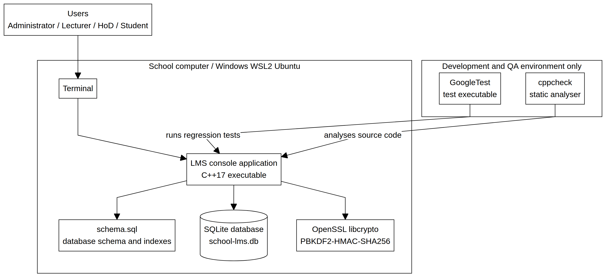

# CS4433 Phase7 Deployment Document

> Source document: `CS4433_Phase7_Deployment_Document.docx`

## CS4433 SOFTWARE ENGINEERING

Phase 7: Deployment Package

Moderated Learning Management System

Student: Itumeleng

Release: Version 1.0

Platform: C++17 console application on Ubuntu/Linux or Windows WSL2

Date: 7 November 2026

This document combines the UML deployment diagram, technician installation guide, user manual, and version 1.0 release notes.

## Contents

1. Deployment architecture

2. Installation guide

3. User manual

4. Version 1.0 release notes

## 1. Deployment architecture

The LMS is deployed as a local C++17 console application on one school computer or a Linux/WSL2 workstation. The application executable, schema.sql and SQLite database are stored on the local filesystem. Users access the system through the terminal. OpenSSL provides password hashing, while GoogleTest is used only in the development and quality-assurance environment.

Figure 1. UML deployment diagram for the local LMS installation.

The runtime is intentionally offline. No web server, remote API or internet connection is required. The SQLite database is excluded from Git and should be backed up by the technician while the application is stopped.

### Deployment components

## 2. Installation guide

This procedure is intended for a school technician installing the LMS on Windows with WSL2 Ubuntu or on a supported Linux computer.

### 2.1 Install WSL2 and Ubuntu on Windows

## Open PowerShell as Administrator and install WSL2 if it is not already available

wsl --install
wsl --set-default-version 2

Restart Windows if requested. Open Ubuntu from the Start menu and create the Ubuntu username and password.

### 2.2 Install dependencies

Inside Ubuntu, install the compiler, build tools, database libraries, cryptographic library, testing tools and Git:

sudo apt update
sudo apt install -y build-essential cmake ninja-build sqlite3 libsqlite3-dev \
  libssl-dev libgtest-dev cppcheck gcovr git

## Verify the installation

c++ --version
cmake --version
ninja --version
sqlite3 --version
openssl version
cppcheck --version
git --version

### 2.3 Obtain the project

## Clone the repository or extract the project archive into the projects directory

mkdir -p ~/projects
cd ~/projects
git clone https://github.com/itumelengr2000-web/CS4433-LMS-Phase4.git lms-phase4
cd lms-phase4

Always run the application from the project root because it loads schema.sql using a relative path.

### 2.4 Build and verify

cmake -S . -B build -G Ninja -DCMAKE_BUILD_TYPE=Release
cmake --build build
ctest --test-dir build --output-on-failure

A valid release installation should report: 100% tests passed, 0 tests failed out of 37.

### 2.5 Create the first database

./build/lms_app school-lms.db --create-admin
./build/lms_app school-lms.db

Enter the initial Administrator username and password when prompted. Password characters are hidden. The password is stored as a salted PBKDF2-HMAC-SHA256 hash and is never stored as plaintext. Use the same database filename on every launch; a different filename creates a different SQLite database.

### 2.6 Backup and recovery

mkdir -p backups
# Stop the LMS first, then:
cp school-lms.db backups/school-lms-$(date +%Y%m%d-%H%M%S).db

To restore a backup, copy it to a new database filename and run the application against that file. Never commit database files or backups to Git.

### 2.7 Troubleshooting

## 3. User manual

This section explains daily use of the LMS for the Administrator, Lecturer, Student and Head of Department.

### 3.1 Login, sign-out and shutdown

cd ~/projects/lms-phase4
./build/lms_app school-lms.db

Enter the exact username and password. Password characters are hidden. Choose 0. Sign out to leave a dashboard. To stop the program completely, press Ctrl+C in the terminal.

### 3.2 First-time setup

Create Lecturer, Student and HoD accounts.

Create a department.

Assign the HoD to the department.

Create a course linked to the department.

Assign the Lecturer to the course.

Enrol the Student in the course.

Sign out and test each role.

Record the displayed IDs because later operations use user, department, course, assignment, submission, batch and mark IDs.

### 3.3 Administrator dashboard

1. Create account
2. Edit account
3. Deactivate account
4. Create department
5. Create course
6. Assign lecturer
7. Enrol student
8. Withdraw student
9. Assign HoD to department
0. Sign out

The Administrator creates accounts, departments and courses, connects lecturers to courses, enrols students, assigns HoDs to departments and deactivates accounts without deleting linked academic records.

### 3.4 Lecturer dashboard

1. Create assignment
2. Edit assignment
3. Activate/deactivate assignment
4. Grant an individual extension
5. View submissions
6. Enter marks and feedback
0. Sign out

The Lecturer manages assignments only for assigned courses. Mark entry validates the raw mark, applies the late penalty, stores feedback, changes the submission status and creates an audit record.

### 3.5 Student dashboard

1. View my courses and active assignments
2. Submit or resubmit an assignment
3. View my submission status
4. View released mark and feedback
0. Sign out

A Student can view active assignments for enrolled courses, submit or resubmit a file, view submission status and view a result only after HoD release. Each submission version has a receipt time and SHA-256 checksum.

### 3.6 Head of Department dashboard

1. Open or select assessment batch
2. View batch marks
3. Approve mark
4. Reject mark
5. Release approved batch
0. Sign out

The HoD can moderate only assignments belonging to the HoD’s department. A batch cannot be released while any mark is pending or rejected. Students can view marks and feedback after complete approval and release.

### 3.7 Security and data rules

Passwords are hidden during console entry and stored as salted PBKDF2-HMAC-SHA256 hashes.

Role, lecturer-course, HoD-department and student-enrolment scope checks are enforced.

Mark changes and moderation decisions are recorded in the audit log.

SQLite database files should be backed up and never committed to Git.

## 4. Version 1.0 release notes

Version 1.0 is the initial deployment release of the Moderated Learning Management System.

### 4.1 Included functionality

Role-based authentication for Administrator, Lecturer, Student and HoD.

Salted PBKDF2-HMAC-SHA256 password hashing using OpenSSL.

Administrator management of accounts, departments, courses, lecturer assignments and enrolments.

Lecturer assignment creation, editing, activation, individual extensions, submission viewing, marking and feedback.

Student assignment viewing, file submission, resubmission versioning, checksums and status tracking.

HoD department-scoped moderation, approval/rejection and complete-batch release.

Late-penalty calculation and effective-deadline handling.

Persistent mark and moderation audit records.

SQLite persistence with foreign keys, normalised tables, indexes and parameterised queries.

CMake/Ninja build and GoogleTest regression suite.

### 4.2 Quality status

### 4.3 Scope and limitations

The release is intentionally a local console application. Web and mobile interfaces, online payment, video conferencing, automated grading, plagiarism detection and multi-site synchronisation are outside the scope of version 1.0.

### 4.4 Upgrade and rollback

Before a future upgrade, stop the application and copy the SQLite database to a protected backup location. If rollback is required, restore the backup under a new filename and run the compatible release executable against it.

### 4.5 Deployment acceptance checklist

WSL2/Ubuntu or a supported Linux system is installed.

C++17 compiler, CMake, Ninja, SQLite, OpenSSL and Git are available.

The Release build completes.

All 37 automated tests pass.

The first Administrator account is created.

The database backup procedure is understood.

The database file is excluded from Git.

All four role dashboards have been tested.

End of Phase 7 Deployment Document

## Table 1

| Component | Purpose | Deployment location |
|---|---|---|
| Terminal / WSL2 Ubuntu | User interface for all four roles. | School computer or technician workstation |
| LMS console executable | Authentication, workflows, validation and business rules. | Local build/bin directory |
| schema.sql | Creates the normalised SQLite tables and indexes. | Project root beside the launch directory |
| SQLite database | Persists accounts, courses, assignments, submissions, marks and audit records. | Protected local filesystem |
| OpenSSL libcrypto | Provides PBKDF2-HMAC-SHA256 password hashing. | Installed system library |
| GoogleTest | Runs automated regression tests during QA. | Development/QA environment only |

## Table 2

| Problem | Technician action |
|---|---|
| Cannot open schema.sql | Run the application from ~/projects/lms-phase4. |
| Incorrect password | Confirm exact username capitalisation and database filename. Password entry is invisible by design. |
| No such table | The command opened an empty database. Use the database filename used when the LMS was created. |
| Build errors | Remove the build directory, reconfigure with CMake and rebuild. |

## Table 3

| Quality gate | Result |
|---|---|
| Release build | PASS |
| Automated tests | 37/37 PASS |
| Production static analysis | PASS; 14 source files checked |
| Implementation line coverage | 80% |
| Critical/high open defects | None |

## Figures and embedded images

