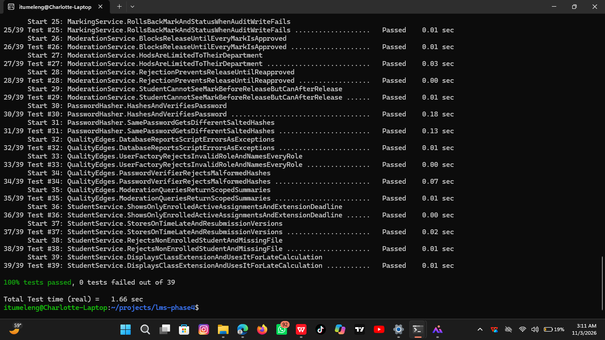
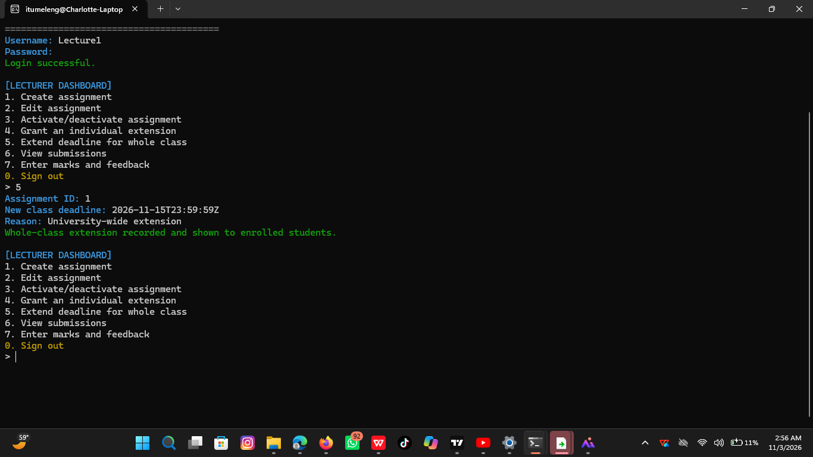

# Phase8RegressionTestResults

> Markdown conversion of the exact supplied Word document `Phase8RegressionTestResults.docx`.

Phase 8 Regression Test Results

Verification command

cmake --build build

ctest --test-dir build --output-on-failure

Result

100% tests passed, 0 tests failed out of 39

The maintenance change added two tests to the previous 37-test suite, and all existing behavior remained passing.

New regression tests

Existing regression areas still passing

The full suite continues to verify authentication, account administration, academic administration, assignment management, individual extensions, late penalties, password hashing, submissions, resubmissions, marking, audit logging, transaction rollback, HoD moderation, release blocking, and student result visibility.

Manual acceptance scenario for CR-01

Log in as the assigned Lecturer.

Open Extend deadline for whole class.

Enter the assignment ID, a later UTC deadline and a reason.

Sign out and log in as an enrolled Student.

Choose View my courses and active assignments.

Confirm the later deadline and [WHOLE-CLASS EXTENSION] label are displayed.

Submit before the new deadline and confirm the system reports ON TIME.

Confirm that an existing individual extension, if present, still takes precedence for that student.

Release decision

CR-01 is accepted for version 1.1 because the implementation meets the acceptance criteria and the complete regression suite passes.

Whole Class extension

Regression test

## Table 1

| Test | Evidence |
|---|---|
| AssignmentService.GrantsAndUpdatesWholeClassExtensionWithinLecturerScope | Assigned lecturer can create and update one class-wide extension; wrong lecturer and non-later deadline are rejected. |
| StudentService.DisplaysClassExtensionAndUsesItForLateCalculation | Student sees the class-wide effective deadline and a submission before that deadline is not late. |

## Embedded screenshots and figures

